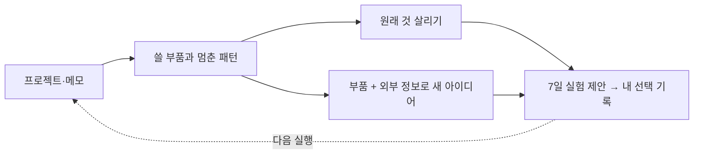

<p align="center">
  <picture>
    <source media="(prefers-color-scheme: dark)" srcset="assets/banner-poster-dark.svg">
    
  </picture>
</p>

# slop-compost

[English](README.md) | **한국어**

[](LICENSE)
[](https://docs.claude.com/en/docs/claude-code)

**만들다 만 프로젝트, 다음엔 어디에 써먹을까요?**

폴더, GitHub URL, 아이디어 한 줄을 넘기면 읽고 정리해 주는 Claude Code 플러그인입니다.

- 다시 쓸 코드·데이터·아이디어와, 자꾸 같은 곳에서 멈추는 패턴을 근거 줄 번호와 함께 찾아줘요.
- 원래 걸 살리는 방법과 부품으로 새로 해 볼 일을 따로 제안해요. 후보마다 7일 실험과 숫자로 확인할 성공·중단 기준이 붙어요.
- `A1 채택, B1 기각`처럼 답하면 기억해 뒀다가, 다음에 “그래서 해 봤어요?” 하고 물어요.

## 30초 맛보기

**실제 실행을 짧게 요약했어요.** 작성자의 프로젝트 4개를 넣었던 첫 실행과, 아이디어 한 줄을 더한 두 번째 실행입니다. 아래 숫자는 실험 목표와 실제 후속 결과를 구분해 적었어요.

| 넣은 것 | 돌아온 것 |
|---|---|
| “부부 가계부, 정산 로직까지 만들고 접음” | 정산 로직은 남기고, 이번 주엔 랜딩 한 장만. 100명 방문 후 이메일 **10건 이상이면 성공, 3건 미만이면 중단** |
| 코드와 메모에서 반복된 행동 | “외부에 보여 주기 전에 기능부터 쌓는다.” 근거: `idea-factory:IMPLEMENTATION-NOTES.md:5-16`, `couple-ledger:text:1` |
| 수집·중복 제거 코드 + 리포트 아이디어 | 대행사에 수작업 리포트 샘플 보내기. **10곳 중 답장 3곳 이상 + 유료 파일럿 1곳이면 성공, 답장 1곳 이하면 중단** |
| 다음 실행에서 알려 준 진행 상황 | “랜딩 만들어 방문 **40**, 가입 **2**.” 지난 선택을 기억하고 여기서 이어감 |

원래 가계부 제안은 “B2C라 안 맞음”으로 기각했어요. 추천을 따르지 않은 이유도 다음 실행의 재료가 됩니다. [실행 로그 펼쳐 보기](#run-log)

## 시작하기

Claude Code 안에서 설치하고:

```text
/plugin marketplace add Leebonggu/slop-compost
/plugin install slop-compost@slop-compost-marketplace
```

만들다 만 걸 넘겨주세요. 폴더 대신 GitHub URL이나 따옴표로 감싼 아이디어 한 줄도 됩니다.

```text
/slop-compost:slop-compost ~/playground/my-project
```

자연어로 “만들다 만 거 정리해서 아이디어 되살려 줘: ~/playground/my-project”라고 해도 돼요.

## 어떻게 돌아가나



- **읽고 짚어요.** 여러 프로젝트에서 반복된 행동을 찾고, 멈춘 이유가 맞는지 한 번에 물어요.
- **두 방향을 따로 생각해요.** 원래 걸 살리는 쪽(트랙 A)과 새 아이디어 쪽(트랙 B)은 서로의 답을 보지 않아요. 억지로 살릴 이유가 없으면 부품만 남기자고 할 수도 있어요.
- **선택을 기억해요.** 채택·보류·기각과 후속 결과를 내 컴퓨터의 `~/.slop-compost`에 쌓아요. 다음에는 그 기록도 참고해요.

## 지키는 규칙

| 결과 | 갖춰야 할 것 |
|---|---|
| 교훈 | `file:line` 등 근거 위치 + 어떤 관찰이 나오면 틀린 말인지 |
| 모든 후보 | 7일 안에 끝낼 첫 실험 + 숫자로 확인할 성공 기준 + 중단 기준 |
| 새 아이디어 | 날짜·출처가 있는 외부 근거 + 실패할 이유 + 비슷한 실패 사례(못 찾으면 실제 검색어) |

스킬이 만든 슬롭도 퇴비가 됩니다. 규칙에 걸린 출력은 추천에서 빼되 `compost.jsonl`에 남겨요. 같은 문제가 쌓이면 자기 지시문을 고치자고 제안하고, 승인받은 변경만 적용해요.

**아무것도 만들지는 않아요.** 분석한 프로젝트는 고치거나 실행하지 않고, 제안과 기록에서 멈춥니다.

<details>
<summary>왜 이렇게 만들었나</summary>

한 AI에게 두 방향을 연달아 물으면 첫 답에 끌려가기 쉬워요. 그래서 입력을 나눠 보조 AI 두 개가 따로 생각하게 했어요. 보조 AI를 쓸 수 없으면 A를 먼저 저장·고정한 뒤, B는 별도 입력으로 작성해요.

성공 사례만 보면 다 될 것 같으니 실패 사례도 찾게 했어요. “시장 검증하기”로 끝나지 않도록 이번 주 할 일과 숫자를 요구하고요. 교훈도 틀렸는지 확인할 수 있어야 쓸모가 있어요.

규칙 개선은 몰래 하지 않아요. 같은 규칙 위반이 3회 이상 실행에 걸쳐 5건 이상 쌓이면 개선을 제안해요. 승인한 내용은 로컬 `overrides.md`에 남으므로 플러그인 업데이트에도 유지됩니다. 자세한 내용은 [설계 문서](docs/DESIGN.md)와 [스킬 지시문](skills/slop-compost/SKILL.md)에 있어요.

</details>

## 출처

새 아이디어를 찾을 때 쓰는 기본 출처 9개예요. 첫 실행에 `~/.slop-compost/sources.md`로 복사하고, 이후에는 내 목록을 씁니다.

| 출처 ID | 살펴보는 것 |
|---|---|
| `hn-show` | Show HN에 올라온 제품과 반응 |
| `github-trending` | 주간 인기 오픈소스, 다시 쓸 만한 기술 |
| `hf-papers` | 새 AI 기술 논문. 수요가 있다는 증거로 쓰지는 않아요 |
| `trustmrr` | 검증된 매출을 공개한 스타트업 사례 |
| `failory` | 실패한 스타트업과 창업자 인터뷰 |
| `failure-search` | 영어·한국어로 찾는 서비스 종료·실패 후기 |
| `geeknews` | GeekNews RSS와 국내 개발자 뉴스 |
| `disquiet` | 국내 메이커의 제품과 개발 기록 |
| `exploding-topics` | 검색 관심도가 오르는 주제 |

기본 목록에서는 자동 접근 차단을 이유로 Product Hunt·Reddit·Indie Hackers를 제외했어요. 유료·구독 제한 콘텐츠도 가져오지 않아요. [출처별 접근 규칙](skills/slop-compost/sources/defaults.md)

```text
/slop-compost:slop-compost sources list
/slop-compost:slop-compost sources add my-notes
# 질문에 한 줄로 답하기: local, ~/my-notes, trend
/slop-compost:slop-compost sources disable trustmrr
/slop-compost:slop-compost sources remove disquiet
```

내 자료도 `local` 출처로 붙일 수 있어요. 폴더나 `~/my-scraper@data:items` 같은 git 참조를 읽으며, `git fetch`는 하지 않아요. 직접 모은 JSON에는 `title`, `summary`, `source_url`, `date`를 넣으면 됩니다. 마크다운도 돼요. [출처 관리 방법](skills/slop-compost/sources/README.md)

## 알아 둘 것

- **가볍진 않아요.** 작성자의 실측은 2회 합계 약 **43만 토큰**, 1회 약 **8분**이었어요. 입력에 따라 달라지며 프로젝트당 핵심 파일은 최대 50개를 읽어요.
- **작은 추가 입력은 덜 읽어요.** 증분 실행에서 새 입력이 아이디어나 글 하나뿐이면, 경량 모드로 외부 출처를 범주당 1개로 줄여요(실패 사례 출처는 그대로). `--full`을 붙이면 전체 재분석합니다.
- **두 번째부터 기록이 빛나요.** 첫 실행도 부품과 패턴을 주지만, 지난 선택과 실제 시도 결과를 참고하려면 기록이 필요해요.
- **외부 정보가 빈약하면 제안도 빈약해요.** 오래되거나 얕은 검색 결과로 수요를 확신할 수는 없어요. AI가 근거를 잘못 읽을 수도 있으니 인용 위치를 확인해 주세요.
- **검색어는 컴퓨터 밖으로 나가요.** 기록은 로컬에 저장하지만, 웹 검색어는 부품과 교훈에서 만들어요. 프로젝트를 설명하는 단어가 검색 서비스에 전달됩니다.
- **아직 v0.1이에요.** 위 실측은 작성자의 두 번 실행 결과이며, 다양한 프로젝트에서의 품질을 보장하는 수치는 아니에요.

## FAQ

**코드가 없어도 되나요?** 네. “이런 걸 만들려다 접었어” 한 줄이나 쓰다 만 글도 받아요.

**코드 못 짰다고 혼내나요?** 코드 품질 채점이 목적은 아니에요. 어디까지 만들었고 왜 멈췄는지, 무엇을 다시 쓸 수 있는지 봅니다.

**계속 안 해 봤다고 하면요?** 후속 질문을 3번 건너뛰면 그 후보는 더 묻지 않아요. 답하기와 건너뛰기는 구분해 기록해요.

<details>
<summary>셸·수동 설치와 환경변수</summary>

셸에서 플러그인 설치:

```bash
claude plugin marketplace add Leebonggu/slop-compost
claude plugin install slop-compost@slop-compost-marketplace --scope user
```

스킬만 수동 설치하려면:

```bash
git clone https://github.com/Leebonggu/slop-compost.git
mkdir -p ~/.claude/skills
cp -R slop-compost/skills/slop-compost ~/.claude/skills/
```

수동 설치 후에는 `/slop-compost ~/playground/my-project`로 불러요. 출처 관리도 `/slop-compost sources list`처럼 앞부분만 줄이면 됩니다.

| 환경변수 | 기본값 | 역할 |
|---|---|---|
| `SLOP_COMPOST_HOME` | `~/.slop-compost` | 기록 저장 위치 |
| `SLOP_COMPOST_LANG` | 자동 감지 | 출력 언어 지정: `ko` 또는 `en` |
| `SLOP_COMPOST_FULL_EVERY` | `10` | 새 입력이 이만큼 쌓이면 지금까지 기록한 프로젝트 전체를 다시 훑어 패턴·교훈을 새로 계산 |

</details>

<a id="run-log"></a>
<details>
<summary>실제 실행 로그 — 두 번의 실행</summary>

기존 README에 실었던 로그를 그대로 옮겼어요. 실제 출력의 발췌본으로, 후보 일부(A1, A3, B2)와 출처 목록은 생략되어 있어요. 기각한 아이디어 이름은 “메모 1·2”로 바꿨습니다.

**실행 1 — 첫 실행, 결과물 4개**

```text
모드: full (첫 실행, 장부 없음 — 4개 모두 new)
결과물: idea-factory (소스 122개 중 18개 읽음), 아이디어 메모 1·2,
        couple-ledger ("부부 공동 가계부 앱 만들다 말았음. 정산 로직까지 만들고 랜딩 없이 접음.")

## 결과물 사이의 패턴
- 주제: 해외 매출(MRR) 사례를 가져와 한국판으로 옮기는 B2B 도구 - 메모 1, 메모 2
- 행동: 외부 접점(랜딩·배포·첫 고객) 없이 구현부터 함
  - idea-factory:IMPLEMENTATION-NOTES.md:5-16, couple-ledger:text:1
- 행동: 적어 둔 검증 실험을 돌리기 전에 보류·기각을 결정함 - 메모 1, 메모 2

## 교훈
- L1 외부 사람이 볼 접점(랜딩·배포)을 만들기 전에 기능부터 쌓은 프로젝트는
     첫 결과물이 나온 직후 멈춘다.
  - idea-factory:state.yaml:4-29, idea-factory:IMPLEMENTATION-NOTES.md:5-16, couple-ledger:text:1
- L2 생성기에 내 맥락(프로필)을 넣지 않으면 결과가 뻔해져서 하루 만에 흥미를 잃는다.
  - idea-factory:agents/idea_generator.py:22-50, idea-factory:PLAN-phase3-7.md:27
- L3 검증 계획을 적어 둔 후보도 그 실험을 돌리기 전에 느낌으로 기각한다. - 메모 1, 메모 2

### 현재 아이디어를 되살린다면 (트랙 A)
#### A2 - 부부 가계부 정산을 "랜딩 한 장"으로만 먼저 내놓는다 (unfinished: 남은 것 중 하나만)
- 부품: couple-ledger#p1 (정산 로직), couple-ledger#p2 (문제 정의)
- 교훈 -> 수정: L1 -> 기능 추가를 막고 랜딩 + 대기자 등록부터. 앱 코드는 이번 주에 안 건드린다.
- 첫 실험 (7일 이내): 정산 예시 화면 + 한 줄 약속 랜딩, 커뮤니티 3곳 + 지인 20명에게 공유. 비용 0원
- 성공: 방문 100명 중 대기자 이메일 10건 이상   |   중단: 방문 100명 도달 후 3건 미만
#### 놓아주기
- idea-factory: 이어 가려는 동기가 안 보인다 -> 놓아 준다. 부품 #p1~#p6
  (중복 제거, LLM 라우터, 반대 근거 스키마 등)은 부품 목록에 남긴다.

### 새 아이디어로 간다면 (트랙 B)
#### B1 - 네이버 플레이스 "대행사용 월간 순위 + 리뷰 리포트"
- 누가 내나: 소상공인 마케팅 대행사, 업체당 월 3~5만원 (가정, 실험으로 확인)
- 부품: 메모 1#p3 (리포트 웨지), idea-factory#p2 (예외 안 던지는 수집 계약), idea-factory#p1 (중복 제거)
- 외부 근거: 네이버가 음식점 대상 AI 리뷰 답글 도구를 베타 적용, 다른 업종으로 확대 예정
  -> 답글 기능은 플랫폼이 흡수, 그래서 리포트 쪽으로 - biz.sbs.co.kr - 2026-04-13
- 반대 증거: 순위 데이터가 비공식 수집에 의존해 차단 한 번에 멈출 수 있다. 대행사는 리포트를
  직접 만드는 경우가 많다. 유사 종료 사례: 검색어 공개, none found
- 첫 실험 (7일 이내): 경쟁사 3곳 직접 확인 -> 실제 업체 1곳 수작업 리포트 -> 대행사 10곳에 샘플 전송
- 성공: 답장 3곳 이상 AND 유료 파일럿 1곳   |   중단: 답장 1곳 이하

퇴비 3건 (02.generic-part: 1, 03.unfalsifiable: 1, 03.multi-claim: 1)

판단: A1 채택 "크몽부터", A2 기각 "B2C라 의도랑 안 맞음", A3 보류, B1 채택 "수작업 리포트 좋음", B2 기각
```

**실행 2 — 같은 날, 아이디어 한 줄 추가**

```text
> /slop-compost "AI로 블로그 글 자동 작성해서 네이버에 올리는 툴, 글 품질 때문에 접음."

모드: incremental (새 결과물 1, 장부의 기존 4개는 재분석 안 함)

## 회상
- 채택 2, 착수 1 (2026-10-15:B1 in-progress "랜딩 만들어 방문 40, 가입 2")
- 2026-10-15:A1 이번에 미응답 (skip 1/3)

## 결과물 사이의 패턴
- 주제: LLM 생성 결과물 품질 불만으로 중단 - ai-naver-blog-writer:text:1, idea-factory:state.yaml:4-29

## 교훈
- L5 (신규) LLM 생성물 품질이 기대에 못 미치면 프롬프트·검수를 고쳐 보기 전에 프로젝트를 접는다.
  - ai-naver-blog-writer:text:1, idea-factory:state.yaml:4-29,
    idea-factory:agents/idea_generator.py:75 (PROMPT_VERSION "v1.0" 그대로)
  - L2(원인: 맥락 미주입)와 별개. L5 는 반응(개선 없이 중단)에 대한 교훈.

퇴비 2건 (03.unfalsifiable: 1, 05b.ev-no-source + ev-no-date + no-experiment + no-number: 1)
```

</details>

<p align="center">
  <picture>
    <source media="(prefers-color-scheme: dark)" srcset="assets/banner-dark.svg">
    
  </picture>
</p>

<p align="center"><b>실패는 성공의 어머니. 슬롭을 심자.</b></p>

[MIT](LICENSE) © 2026 Leebonggu
