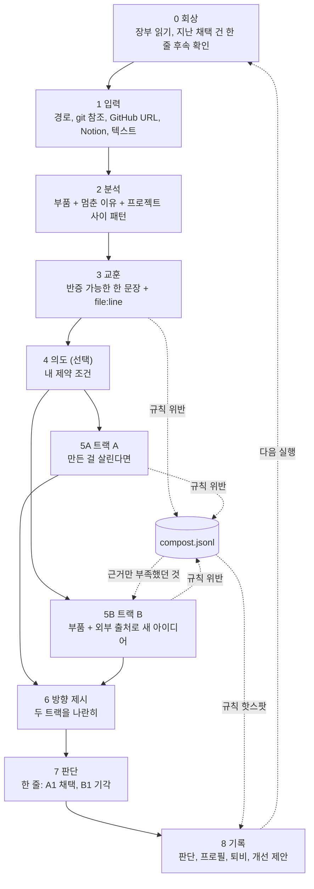

<p align="center">
  <picture>
    <source media="(prefers-color-scheme: dark)" srcset="assets/banner-poster-dark.svg">
    
  </picture>
</p>

# slop-compost

[English](README.md) | **한국어**

[](LICENSE)
[](https://docs.claude.com/en/docs/claude-code)

**실패는 성공의 어머니. 슬롭은 다음 아이디어의 거름이다.**

> `~/playground` 에 만들다 만 폴더가 몇 개인지 세어 본 적 있나요? 이 스킬이 대신 열어 보고, 쓸 만한 부품을 건지고, 왜 매번 40%쯤에서 멈추는지 줄 번호까지 짚어 줍니다.

## 처음이라면 이것만

1. **설치** — Claude Code 안에서 두 줄:
   ```
   /plugin marketplace add Leebonggu/slop-compost
   /plugin install slop-compost@slop-compost-marketplace
   ```
2. **실행** — 만들다 만 폴더를 넘깁니다: `/slop-compost:slop-compost ~/playground/내-프로젝트` (아이디어 한 줄만 따옴표로 넘겨도 됩니다)
3. **한 줄로 답하기** — 질문은 몇 번 안 됩니다. 마지막에 나온 후보에 `A1 채택, B1 기각` 처럼 한 줄로 답하면 끝입니다.

나머지는 궁금할 때 아래에서 찾아보세요.

## 세 줄 요약

- [Claude Code](https://docs.claude.com/en/docs/claude-code)(터미널에서 쓰는 Claude) 스킬입니다. 버린 저장소, 쓰다 만 글, 한 줄짜리 아이디어를 넘기면 됩니다.
- **다시 쓸 부품**과 **file:line 근거가 붙은 교훈**을 뽑고, 서로를 못 보는 두 방향을 냅니다. 원래 걸 살리는 길(트랙 A)과 부품으로 새로 만드는 길(트랙 B).
- 아무것도 만들지 않습니다. 판단은 한 줄(`A1 채택, B1 기각`)로 하고, 내 컴퓨터의 장부(기록 폴더)에 쌓여서 두 번째 실행은 첫 번째보다 나를 더 잘 압니다.

## 문제

시작이 반이라는데, 나머지 반은 아무도 안 해 줍니다.

AI 덕분에 시작하는 비용은 거의 0이 됐습니다. 끝내는 비용은 그대로입니다. 그래서 40%까지 간 저장소, 문제 정의만 날카롭고 코드는 없는 README, 아무도 안 들어온 랜딩 페이지가 쌓입니다. 누구나 그렇습니다.

보통은 지우거나 잊습니다. 그러면 이미 값을 치른 두 가지를 같이 버립니다.

- **부품**: 잘 돌던 파서, 꽤 괜찮았던 문제 정의, 긁어 모은 데이터.
- **교훈**: *왜* 멈췄는지. 그리고 그게 지난번과 같은 이유인지.

실패는 성공의 어머니라지만, 누군가 실패를 읽어 줘야 그렇습니다. 그 읽는 일을 이 스킬이 합니다.

## 실제로 하는 일

0부터 8까지 9단계입니다. 단계마다 끝에 "Reject if"(이러면 버린다) 체크리스트가 있고, 사용자에게 보여 주기 전에 먼저 돌립니다.



핵심은 5단계입니다.

- **트랙 A**: "만든 걸 살린다면 될 수도 있는 가장 작은 길은?" 멈춘 이유마다 정해진 처방을 씁니다. `unfinished`(못 끝냄)는 범위를 하나로 자르고, `no-revenue`(돈이 안 됨)는 누가 내는지·가격·채널 중 한 변수만 바꿉니다. `abandoned`(손을 놓음)인데 이어 갈 동기가 안 보이면 후보 대신 "놓아주기" 메모를 씁니다. 부품만 남기고 보내 주자는 뜻입니다.
- **트랙 B**: "놓고 간다면 이 부품들이 가리키는 새 아이디어는?" 가능하면 서로 다른 프로젝트의 부품을 묶고, 외부 출처(아래 "출처 관리")에서 찾은 신호와 맞춥니다. 반대 증거는 필수입니다.
- 두 트랙은 **서로의 파일을 읽을 수 없는 서브에이전트**(따로 도는 보조 AI)로 동시에 돕니다. 서브에이전트를 못 쓰는 환경에서는 A 를 먼저 쓰고 고정한 뒤 B 를 씁니다. 두 트랙이 따로 같은 결론에 닿으면 `수렴: A1 ≈ B2` 로 표시합니다. 독립된 두 길이 같은 곳에 닿았다는 건 강한 신호입니다.

두 트랙 모든 후보에는 7일 안에 끝나는 첫 실험, 숫자로 된 성공 기준, 중단 기준이 붙습니다.

## 실행 예시

**실제 실행, 줄인 것.** 작성자의 실패작으로 두 번 돌린 결과입니다. 기각해 둔 아이디어 메모 2개는 이름을 "메모 1·2"로 바꿨고, 후보 일부(A1, A3, B2)와 출처 목록은 생략했습니다.

**실행 1** — 첫 실행, 결과물 4개

```text
모드: full (첫 실행, 장부 없음 — 4개 모두 new)
결과물: idea-factory (소스 122개 중 18개 읽음), 아이디어 메모 1·2,
        couple-ledger ("부부 공동 가계부 앱 만들다 말았음. 정산 로직까지 만들고 랜딩 없이 접음.")

## 결과물 사이의 패턴
- 주제: 해외 매출(MRR) 사례를 가져와 한국판으로 옮기는 B2B 도구 - 메모 1, 메모 2
- 행동: 외부 접점(랜딩·배포·첫 고객) 없이 구현부터 함
  - idea-factory:IMPLEMENTATION-NOTES.md:5-16, couple-ledger:text:1
- 행동: 적어 둔 검증 실험을 돌리기 전에 보류·기각을 결정함 - 메모 1, 메모 2

## 교훈
- L1 외부 사람이 볼 접점(랜딩·배포)을 만들기 전에 기능부터 쌓은 프로젝트는
     첫 결과물이 나온 직후 멈춘다.
  - idea-factory:state.yaml:4-29, idea-factory:IMPLEMENTATION-NOTES.md:5-16, couple-ledger:text:1
- L2 생성기에 내 맥락(프로필)을 넣지 않으면 결과가 뻔해져서 하루 만에 흥미를 잃는다.
  - idea-factory:agents/idea_generator.py:22-50, idea-factory:PLAN-phase3-7.md:27
- L3 검증 계획을 적어 둔 후보도 그 실험을 돌리기 전에 느낌으로 기각한다. - 메모 1, 메모 2

### 현재 아이디어를 되살린다면 (트랙 A)
#### A2 - 부부 가계부 정산을 "랜딩 한 장"으로만 먼저 내놓는다 (unfinished: 남은 것 중 하나만)
- 부품: couple-ledger#p1 (정산 로직), couple-ledger#p2 (문제 정의)
- 교훈 -> 수정: L1 -> 기능 추가를 막고 랜딩 + 대기자 등록부터. 앱 코드는 이번 주에 안 건드린다.
- 첫 실험 (7일 이내): 정산 예시 화면 + 한 줄 약속 랜딩, 커뮤니티 3곳 + 지인 20명에게 공유. 비용 0원
- 성공: 방문 100명 중 대기자 이메일 10건 이상   |   중단: 방문 100명 도달 후 3건 미만
#### 놓아주기
- idea-factory: 이어 가려는 동기가 안 보인다 -> 놓아 준다. 부품 #p1~#p6
  (중복 제거, LLM 라우터, 반대 근거 스키마 등)은 부품 목록에 남긴다.

### 새 아이디어로 간다면 (트랙 B)
#### B1 - 네이버 플레이스 "대행사용 월간 순위 + 리뷰 리포트"
- 누가 내나: 소상공인 마케팅 대행사, 업체당 월 3~5만원 (가정, 실험으로 확인)
- 부품: 메모 1#p3 (리포트 웨지), idea-factory#p2 (예외 안 던지는 수집 계약), idea-factory#p1 (중복 제거)
- 외부 근거: 네이버가 음식점 대상 AI 리뷰 답글 도구를 베타 적용, 다른 업종으로 확대 예정
  -> 답글 기능은 플랫폼이 흡수, 그래서 리포트 쪽으로 - biz.sbs.co.kr - 2026-04-13
- 반대 증거: 순위 데이터가 비공식 수집에 의존해 차단 한 번에 멈출 수 있다. 대행사는 리포트를
  직접 만드는 경우가 많다. 유사 종료 사례: 검색어 공개, none found
- 첫 실험 (7일 이내): 경쟁사 3곳 직접 확인 -> 실제 업체 1곳 수작업 리포트 -> 대행사 10곳에 샘플 전송
- 성공: 답장 3곳 이상 AND 유료 파일럿 1곳   |   중단: 답장 1곳 이하

퇴비 3건 (02.generic-part: 1, 03.unfalsifiable: 1, 03.multi-claim: 1)

판단: A1 채택 "크몽부터", A2 기각 "B2C라 의도랑 안 맞음", A3 보류, B1 채택 "수작업 리포트 좋음", B2 기각
```

**실행 2** — 같은 날, 아이디어 한 줄만 추가

```text
> /slop-compost "AI로 블로그 글 자동 작성해서 네이버에 올리는 툴, 글 품질 때문에 접음."

모드: incremental (새 결과물 1, 장부의 기존 4개는 재분석 안 함)

## 회상
- 채택 2, 착수 1 (2026-10-15:B1 in-progress "랜딩 만들어 방문 40, 가입 2")
- 2026-10-15:A1 이번에 미응답 (skip 1/3)

## 결과물 사이의 패턴
- 주제: LLM 생성 결과물 품질 불만으로 중단 - ai-naver-blog-writer:text:1, idea-factory:state.yaml:4-29

## 교훈
- L5 (신규) LLM 생성물 품질이 기대에 못 미치면 프롬프트·검수를 고쳐 보기 전에 프로젝트를 접는다.
  - ai-naver-blog-writer:text:1, idea-factory:state.yaml:4-29,
    idea-factory:agents/idea_generator.py:75 (PROMPT_VERSION "v1.0" 그대로)
  - L2(원인: 맥락 미주입)와 별개. L5 는 반응(개선 없이 중단)에 대한 교훈.

퇴비 2건 (03.unfalsifiable: 1, 05b.ev-no-source + ev-no-date + no-experiment + no-number: 1)
```

두 번째 실행은 지난 채택 후보의 실제 숫자(방문 40, 가입 2)로 시작하고, 새 결과물 하나로 이전 프로젝트와 이어지는 교훈을 찾았습니다. 이게 성장 루프입니다.

<details>
<summary><b>설계 결정 (왜 이렇게 만들었나)</b></summary>

**두 트랙이 서로를 못 보는 이유.** 한 모델에게 "살릴까, 갈아탈까?"를 물으면 먼저 나온 답이 다음 답을 끌고 갑니다. 입력 파일부터 따로 받는 서브에이전트로 나눠야 트랙 B 가 "이름만 바꾼 트랙 A"가 되지 않습니다. 트랙 B 입력에서는 트랙 A 를 언급한 문장도 일반화합니다.

**트랙 B 가 반대 증거 없는 후보를 버리는 이유.** 트렌드·매출 사례는 살아남은 것만 보여 줍니다. 그래서 트랙 B 후보는 구체적인 실패 메커니즘과, 비슷하게 하다 접은 사례를 출처·날짜와 함께 내야 합니다(못 찾았다면 실제로 돌린 검색어라도). 둘 중 하나라도 없으면 퇴비로 갑니다.

**7일 실험과 숫자가 없으면 후보가 아닌 이유.** "시장 검증"은 계획이 아닙니다. 이번 주에 뭘 하고 어떤 숫자가 나오면 접을지 말할 수 있어야 실제로 움직일 수 있습니다.

**file:line 없는 교훈을 버리는 이유.** "UX 개선 필요"는 틀릴 수가 없어서 아무것도 알려 주지 않습니다. 교훈은 틀릴 수도 있는 한 문장에, 자료 속 근거 위치와 "무엇이 관찰되면 틀린 것인지"가 붙어야 합니다. 3번 이상 반복되면 "구조적 습관"으로 올라갑니다.

**스킬 자신의 슬롭도 퇴비가 됩니다.** 규칙을 어긴 출력은 사용자에게 안 보이지만 지워지지도 않습니다. 어긴 규칙 id 와 함께 `compost.jsonl` 에 쌓입니다. 같은 규칙이 3번 이상의 실행에서 5건 이상 걸리면 스킬이 자기 지시문을 고치자고 제안합니다. 근거만 부족해서 떨어진 트랙 B 후보는 나중 실행에서 다시 재료가 될 수 있습니다. 단, 빠졌던 근거를 실제로 채운 뒤에만. 스킬도 자기 실패작을 거름으로 씁니다.

**아무것도 만들지 않는 이유.** 제안에서 멈춥니다. 코드를 실행하지도, 저장소를 고치지도, "부활한 버전"의 뼈대를 깔아 주지도 않습니다. 고르는 건 사용자 몫입니다.

**승인한 개선이 `overrides.md` 에 쌓이는 이유.** 플러그인 파일은 업데이트하면 덮어써지는 캐시에 있습니다. 그래서 스킬은 자기 파일을 고치지 않고, 승인한 변경을 장부의 `overrides.md` 에 덧붙여 매 실행마다 스킬 위에 덧씌웁니다. 모두에게 쓸모 있는 변경이면 내보내기를 요청하세요. 횟수만 담은 이유(프로젝트 이름 없음)와 diff 제안을 써 주고, PR 은 직접 엽니다.

**질문을 한 줄로 받는 이유.** 후속 확인, 멈춘 이유, 판단은 각각 한 번에 묶어서 묻습니다. `A1 a, B2 r` 이 대화의 전부일 수 있습니다. 못 끝낸 프로젝트에 대한 긴 설문은 또 하나의 못 끝낸 일이 되니까요.

</details>

## 설치

**마켓플레이스 (Claude Code 안에서)**

```
/plugin marketplace add Leebonggu/slop-compost
/plugin install slop-compost@slop-compost-marketplace
```

**셸에서**

```bash
claude plugin marketplace add Leebonggu/slop-compost
claude plugin install slop-compost@slop-compost-marketplace --scope user
```

**수동 설치 (스킬만)**

```bash
git clone https://github.com/Leebonggu/slop-compost.git
cp -R slop-compost/skills/slop-compost ~/.claude/skills/
# 업데이트를 쉽게 하려면 심링크:
ln -s "$PWD/slop-compost/skills/slop-compost" ~/.claude/skills/slop-compost
```

## 사용법

```
# 플러그인 설치
/slop-compost:slop-compost ~/playground/idea-factory https://github.com/me/old-repo "니치 B2B 뉴스레터를 팟캐스트로"

# 수동 설치
/slop-compost ~/playground/idea-factory ~/notes/dropped-ideas.md ~/my-scraper@data:items
```

입력은 로컬 폴더, git 참조(`<저장소>@<브랜치>:<경로>`, 예: `~/my-scraper@data:items`), GitHub URL(비공개는 `gh` 로), Notion 페이지(Notion MCP 가 연결돼 있으면), 그 밖의 URL, 그냥 텍스트 모두 됩니다. 섞어도 됩니다. 10개가 넘으면 토큰을 쓰기 전에 한 번 묻습니다.

자연어로 불러도 됩니다.

- "만들다 만 거 정리해서 아이디어 되살려 줘"
- "버린 프로젝트 세 개인데 건질 거 있어?"
- "실패작 퇴비로 만들어 줘: ~/playground/*"

인자: `--full` 은 전체 재분석(첫 실행은 항상 전체 분석).

## 출처 관리

트랙 B 가 읽는 외부 출처 목록입니다. 첫 실행 때 기본 9개를 장부의 `sources.md` 로 복사하고, 그 뒤로는 내 목록이 기준입니다. 플러그인 업데이트로 기본 출처가 늘면 "새 기본 출처 N개 — 추가할까요?" 한 줄로만 묻습니다.

| 이름 | 범주 | 한 줄 |
|---|---|---|
| hn-show | trend | Hacker News "Show HN": 이번 주 사람들이 내놓은 것 |
| github-trending | ai-trend | 주간 GitHub 트렌딩: 막 싸진 기능 |
| hf-papers | ai-trend | Hugging Face 논문: 부품을 더 싸게 만드는 새 기술 |
| trustmrr | revenue | 매출이 검증된 스타트업 사례 |
| failory | failure | 실패 스타트업 묘지·창업자 인터뷰 (원인·종료 연도 필드) |
| failure-search | failure | "서비스 종료 후기" 류 검색 (영어·한국어) |
| geeknews | community-ko | GeekNews RSS: 국내 개발자 뉴스 |
| disquiet | community-ko | 디스콰이엇: 국내 메이커 커뮤니티 |
| exploding-topics | trend | 검색량이 오르는 주제 |

Product Hunt(자동 접근 403), Reddit(robots 전체 차단), Indie Hackers(403), 유료·구독 제한 사이트는 기본 목록에 넣지 않았습니다.

```
/slop-compost sources list                 # 목록 + 출처별 인용·채택 인용 수
/slop-compost sources add my-notes         # 한 줄로 답: local, ~/my-notes, trend
/slop-compost sources add my-scraper       # 한 줄로 답: local, ~/my-scraper@data:items, revenue
/slop-compost sources disable trustmrr
/slop-compost sources remove disquiet      # 지우지 않고 removed 날짜만 표시
```

- `local` 타입은 폴더(`~/my-notes`) 또는 git 참조(`~/my-scraper@data:items`)입니다. git 참조는 `fetch` 없이 이미 있는 브랜치를 읽고, 오래됐으면 fetch 명령만 알려 줍니다.
- 내 수집기를 붙이려면 `title`, `summary`, `source_url`, `date` 필드를 가진 JSON(또는 마크다운)을 그 폴더나 브랜치에 두면 됩니다.
- 트랙 B 근거마다 어느 출처에서 왔는지 기록합니다. 최근 5번 실행 동안 채택한 후보에 한 번도 쓰이지 않은 출처는 "끌까요?"라고 제안합니다(승인해야 꺼짐).

## 설정

| 변수 | 기본값 | 역할 |
|---|---|---|
| `SLOP_COMPOST_HOME` | `~/.slop-compost` | 장부 위치 |
| `SLOP_COMPOST_LANG` | 자동 감지 | 출력 언어 강제: `en` 또는 `ko` |
| `SLOP_COMPOST_FULL_EVERY` | `10` | 새 결과물이 이만큼 쌓이면 전체 재분석 |

## 프라이버시

```
~/.slop-compost/
├── artifacts/<id>.md    parts.jsonl    lessons.md    intents.md
├── decisions.jsonl      compost.jsonl  profile.md    proposals.md    overrides.md
├── sources.md           runs/<date>.md state.json    export/
```

- 장부는 로컬에만 있습니다. 스킬은 장부 데이터를 어디에도 보내지 않습니다.
- **트랙 B 는 웹 검색·페이지 읽기를 합니다.** 검색어는 부품과 교훈으로 만들어지므로, 내 프로젝트를 설명하는 단어가 검색 엔진으로 갑니다. 파일 자체는 가지 않습니다.
- 분석 대상 저장소는 읽기만 합니다. GitHub 저장소는 실행별 작업 폴더에 복제하고, 코드는 실행하지 않습니다. DB 파일은 복사본으로만 엽니다.
- `export/` 는 v0.1 에서 형식만 있습니다. 요청할 때만 익명화된 요약을 씁니다. 업로드는 없습니다.

## 한계

- **토큰을 꽤 씁니다.** 실측: 위 예시 2번 실행에 약 43만 토큰, 1번에 약 8분. 프로젝트당 핵심 파일 최대 50개, 서브에이전트 2개, 출처 한 바퀴가 들어갑니다.
- **경량 모드**: 증분 실행에서 새 결과물이 아이디어나 글 하나뿐이면 트랙 B 출처를 범주당 1개로 줄입니다. 실행 직전에 "트랙 2개, 출처 N개" 한 줄로 규모를 보여 줍니다.
- **트랙 B 품질은 출처가 돌려주는 것만큼입니다.** 결과가 얇거나 오래되면 후보도 얇습니다. 한국 사이트는 웹 검색 결과가 빈약할 때가 많아 RSS 같은 직접 읽기를 우선합니다.
- **장부는 두 번째 실행부터 진가가 나옵니다.** 첫 실행은 부품과 패턴까지입니다. 후속 확인, 반복 교훈, 프로필은 이력이 있어야 합니다.
- **결국 LLM 의 판단입니다.** 멈춘 이유 추측은 틀릴 수 있고(그래서 확인을 받습니다), 인용한 줄을 잘못 읽을 수도 있습니다. 인용은 직접 확인하세요.
- **v0.1 입니다.** 아직 evals 가 없습니다. 퇴비가 쌓이면서 규칙은 바뀔 겁니다.

## FAQ

**그냥 회고 템플릿 아닌가요?**
템플릿은 저장소를 열어 `agents/idea_generator.py:22-50` 을 찾아내지도, 두 프로젝트가 같은 지점에서 멈췄다는 걸 알아채지도, 비슷하게 하다 접은 제품을 찾아보지도 않습니다. 지난번에 뭘 채택했는지 기억했다가 다음에 "그래서 시작은 했어요?"라고 묻지도 않고요.

**코드 품질을 평가하나요?**
아니요. 루브릭에 "지저분한 코드"를 교훈으로 삼지 말라고 적혀 있습니다. 어디까지 갔는지(의도, 실행, 핵심 경로, 사용 가능, 배포, 실사용)와 무엇이 멈추게 했는지를 봅니다.

**내 프로젝트를 고쳐 쓰나요?**
아니요. 입력은 읽기 전용이고 아무것도 만들지 않습니다. 결과물은 문서 한 장과 장부 기록입니다.

**후속 확인을 계속 건너뛰면요?**
같은 항목을 3번 건너뛰면 stale 로 표시되고 다시 묻지 않습니다. 잔소리는 세 번까지입니다.

## 로드맵

- **공용 아이디어 묘지** (opt-in): 익명화한 내보내기를 공유해 남의 실패에서 배우기. 내보낼 때마다 동의.
- **출처 확장**: 기본 출처 추가, 출처 성과에 따른 추천.
- **Evals**: 고정 입력으로 교훈이 반증 가능하게, 후보가 실험 가능하게 유지되는지 확인.

## 문서

- 설계: [docs/DESIGN.md](docs/DESIGN.md)
- 스킬 진입점: [skills/slop-compost/SKILL.md](skills/slop-compost/SKILL.md)
- 출처 규칙: [skills/slop-compost/sources/README.md](skills/slop-compost/sources/README.md)

<p align="center">
  <picture>
    <source media="(prefers-color-scheme: dark)" srcset="assets/banner-dark.svg">
    
  </picture>
</p>

<p align="center"><b>슬롭을 심자.</b></p>

## 라이선스

[MIT](LICENSE) © 2026 Leebonggu
