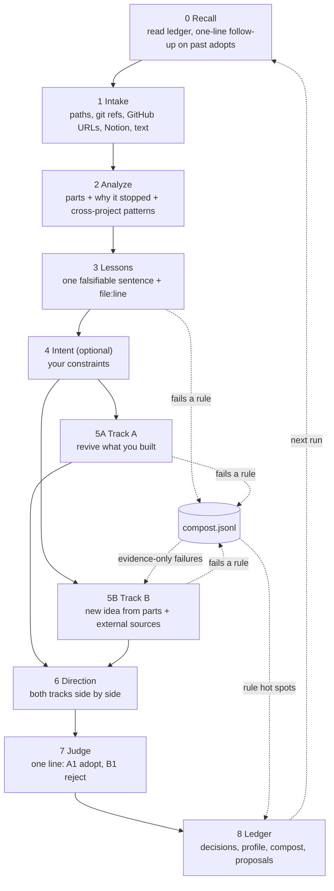

<p align="center">
  <picture>
    <source media="(prefers-color-scheme: dark)" srcset="assets/banner-poster-dark.svg">
    
  </picture>
</p>

# slop-compost

**English** | [한국어](README.ko.md)

[](LICENSE)
[](https://docs.claude.com/en/docs/claude-code)

**Failure is the mother of success. Your slop is compost for the next idea.**

> Every repo in your `~/playground` was a great idea for one weekend. This skill reads them, keeps the parts that worked, and shows you, with line numbers, why you tend to stop around 40%.

## New here? Just do this

1. **Install** - two lines inside Claude Code:
   ```
   /plugin marketplace add Leebonggu/slop-compost
   /plugin install slop-compost@slop-compost-marketplace
   ```
2. **Run** - hand it an abandoned folder: `/slop-compost:slop-compost ~/playground/my-project` (a one-sentence idea in quotes works too)
3. **Answer in one line** - there are only a few questions. At the end, reply to the candidates with something like `A1 adopt, B1 reject` and you are done.

Everything else below is for when you are curious.

## TL;DR

- A [Claude Code](https://docs.claude.com/en/docs/claude-code) (Claude in your terminal) skill. Point it at abandoned repos, drafts, or one-sentence ideas.
- It extracts **reusable parts** and **lessons that cite file:line**, then writes two directions that never see each other: revive the old thing (Track A) or build something new from the parts (Track B).
- It builds nothing. You answer in one line (`A1 adopt, B1 reject`), and a local ledger (a folder of plain records on your machine) remembers, so run #2 knows you better than run #1.

## The problem

AI made starting a project nearly free. Finishing costs exactly what it used to.

So the pile grows: repos that got to 40%, a README with a sharp problem statement and no code, a landing page nobody visited. It happens to everyone.

The usual move is to delete or forget. That throws away two things you already paid for:

- **Parts**: the parser that worked, the problem statement that was actually good, the dataset you scraped.
- **Lessons**: *why* it stopped, and whether it is the same reason as last time.

Failure is the mother of success, but only if somebody reads the failure. This skill does the reading.

## What it actually does

Nine steps, 0 to 8. Each step ends with a "Reject if" checklist that runs before you see anything.



The core is step 5:

- **Track A** asks: "If you revive what you built, what is the smallest path that could work?" It applies a fixed prescription per stop reason. `unfinished` means cut scope to one thing. `no-revenue` means change who pays, the price, or the channel, one variable at a time. `abandoned` with no sign of motivation gets a release note instead of a candidate: let it go, keep the parts.
- **Track B** asks: "If you leave it behind, what new idea do these parts point to?" It combines parts (ideally from different projects) with signals from external sources (see "Managing sources" below), and must bring counter-evidence.
- They run as **two subagents** (separate helper AIs running in parallel) **that cannot read each other's files**. Without subagents, Track A is written and frozen before Track B starts. If both tracks independently land on the same direction, the output marks it `Convergence: A1 ≈ B2`. Two independent paths reaching the same place is a strong signal.

Every candidate, in both tracks, has a first experiment that fits in 7 days, a numeric success criterion, and a kill criterion.

## A real run

**Real run, trimmed. Translated from a Korean run.** Two runs on the author's own abandoned projects. Two shelved idea memos are renamed "memo 1" and "memo 2"; some candidates (A1, A3, B2) and the source list are cut.

**Run 1** - first run, 4 artifacts

```text
Mode: full (first run, no ledger - all 4 new)
Artifacts: idea-factory (read 18 of 122 source files), idea memos 1 and 2,
           couple-ledger ("Was building a shared budget app for couples. Built the
           settlement logic, quit without a landing page.")

## Patterns across artifacts
- Theme: porting a foreign MRR case into a Korean B2B tool - memo 1, memo 2
- Behavior: builds features before any outside touchpoint (landing, deploy, first customer)
  - idea-factory:IMPLEMENTATION-NOTES.md:5-16, couple-ledger:text:1
- Behavior: shelves or rejects ideas before running the validation written down for them - memo 1, memo 2

## Lessons
- L1 Projects that pile up features before anything an outsider can see (landing, deploy)
     stop right after the first output.
  - idea-factory:state.yaml:4-29, idea-factory:IMPLEMENTATION-NOTES.md:5-16, couple-ledger:text:1
- L2 Without my own context (profile) in the generator, output turns generic and I lose interest in a day.
  - idea-factory:agents/idea_generator.py:22-50, idea-factory:PLAN-phase3-7.md:27
- L3 Even candidates with a written validation plan get rejected on gut feeling before the test runs.
  - memo 1, memo 2

### If you revive the current idea (Track A)
#### A2 - Ship the couples' budget settlement as a single landing page first (unfinished: finish one thing)
- Parts: couple-ledger#p1 (settlement logic), couple-ledger#p2 (problem statement)
- Lessons -> changes: L1 -> freeze features; landing + waitlist first. No app code this week.
- First experiment (<= 7 days): landing with a settlement example + one-line promise,
  shared in 3 communities + 20 acquaintances. Cost: 0
- Success: >= 10 waitlist emails per 100 visits   |   Kill: < 3 after 100 visits
#### Release note
- idea-factory: no sign of motivation to continue -> let it go. Parts #p1-#p6
  (dedupe, LLM router, counter-argument schema, ...) stay in the parts list.

### If you go for a new idea (Track B)
#### B1 - Monthly rank + review report for local-marketing agencies (Naver Place)
- Who pays: small marketing agencies, ~30-50k KRW per client per month (assumption, to be tested)
- Parts: memo 1#p3 (report wedge), idea-factory#p2 (never-throw crawler contract), idea-factory#p1 (dedupe)
- External evidence: Naver started applying an AI review-reply tool to restaurants in beta,
  with other categories planned -> the reply feature gets absorbed by the platform, so go
  for reports - biz.sbs.co.kr - 2026-04-13
- Counter-evidence: rank data depends on unofficial collection and can break with one block;
  agencies often build reports themselves. Similar shutdowns: queries shown, none found
- First experiment (<= 7 days): check 3 competitors by hand -> one manual report for a real
  business -> send samples to 10 agencies
- Success: >= 3 replies AND 1 paid pilot   |   Kill: <= 1 reply

Composted 3 (02.generic-part: 1, 03.unfalsifiable: 1, 03.multi-claim: 1)

Judgments: A1 adopt, A2 reject "B2C doesn't fit my intent", A3 hold, B1 adopt "manual report is good", B2 reject
```

**Run 2** - same day, one more idea

```text
> /slop-compost "A tool that auto-writes blog posts with AI and posts them to Naver. Quit over post quality."

Mode: incremental (1 new artifact; the 4 in the ledger are not re-analyzed)

## Recall
- Adopted 2, started 1 (2026-10-15:B1 in-progress "made a landing page: 40 visits, 2 signups")
- 2026-10-15:A1 not answered this time (skip 1/3)

## Patterns across artifacts
- Theme: stopped over LLM output quality - ai-naver-blog-writer:text:1, idea-factory:state.yaml:4-29

## Lessons
- L5 (new) When LLM output disappoints, I quit before revising the prompt or adding review.
  - ai-naver-blog-writer:text:1, idea-factory:state.yaml:4-29,
    idea-factory:agents/idea_generator.py:75 (PROMPT_VERSION still "v1.0")
  - Separate from L2 (cause: no context). L5 is about the reaction (quitting without iterating).

Composted 2 (03.unfalsifiable: 1, 05b.ev-no-source + ev-no-date + no-experiment + no-number: 1)
```

Run 2 opens with the real numbers from the last adopted candidate (40 visits, 2 signups), and one new idea was enough to find a lesson linking it to an older project. That is the growth loop.

<details>
<summary><b>Design decisions (the "why")</b></summary>

**Why two tracks that can't see each other.** Ask one model "revive or pivot?" and the first answer anchors the second. Separate subagents with separate input files keep Track B from becoming "Track A with a new name". Sentences in Track B's input that mention Track A are generalized too.

**Why Track B drops candidates without counter-evidence.** Trend and revenue examples only show survivors. Every Track B candidate must name a specific failure mechanism *and* a similar attempt that died, with source and date (or the exact queries that found nothing). Missing either one, it is composted.

**Why no 7-day experiment + number means no candidate.** "Validate the market" is not a plan. Knowing what you will do this week and which number means stop is what makes a candidate something you can actually start.

**Why lessons without file:line are dropped.** "Need better UX" can never be wrong, so it teaches nothing. A lesson is one sentence that could turn out false, with a location in your material and a falsifier. A lesson that repeats in 3+ runs gets promoted to "structural habit".

**Even its own slop is compost.** Output that breaks a rule is hidden from you but not deleted. It goes to `compost.jsonl` with the rule id it broke. If one rule fails in 3+ runs (5+ entries), the skill proposes a fix to its own instructions. A Track B candidate that failed *only* on evidence can come back in a later run, but only after the missing evidence is actually found. The skill composts its own failures too.

**Why it never builds anything.** It stops at proposals. It does not run your code, edit your repos, or scaffold the "revived" version. Choosing is your part.

**Why approved improvements go to `overrides.md`.** Plugin files live in a cache that updates overwrite. So the skill never edits its own files: approved changes are appended to `overrides.md` in your ledger and applied on top of the skill each run. If one would help everyone, ask for an export: you get a suggested diff with counts-only reasoning (no project names), and you open the PR yourself.

**Why questions are one line.** Follow-ups, stop reasons, and judgments are each one batched question. `A1 a, B2 r` can be the whole interaction. A long survey about unfinished projects would just become another unfinished project.

</details>

## Install

**From the marketplace (inside Claude Code)**

```
/plugin marketplace add Leebonggu/slop-compost
/plugin install slop-compost@slop-compost-marketplace
```

**From the shell**

```bash
claude plugin marketplace add Leebonggu/slop-compost
claude plugin install slop-compost@slop-compost-marketplace --scope user
```

**Manual (skill only)**

```bash
git clone https://github.com/Leebonggu/slop-compost.git
cp -R slop-compost/skills/slop-compost ~/.claude/skills/
# or keep it updatable with a symlink:
ln -s "$PWD/slop-compost/skills/slop-compost" ~/.claude/skills/slop-compost
```

## Usage

```
# plugin install
/slop-compost:slop-compost ~/playground/idea-factory https://github.com/me/old-repo "a podcast for niche B2B newsletters"

# manual install
/slop-compost ~/playground/idea-factory ~/notes/dropped-ideas.md ~/my-scraper@data:items
```

Inputs can be local folders, git references (`<repo>@<branch>:<path>`, e.g. `~/my-scraper@data:items`), GitHub URLs (private ones via `gh`), Notion pages (if the Notion MCP is connected), other URLs, or plain text. Mix freely. With more than 10 inputs it asks before spending tokens.

Or just ask:

- "Here are three side projects I abandoned, what can I salvage?"
- "Compost my slop: ~/playground/*"
- "만들다 만 거 정리해서 아이디어 되살려 줘"

Flag: `--full` forces a full re-analysis (the first run is always full).

## Managing sources

These are the external sources Track B reads. On the first run the 9 defaults are copied to `sources.md` in your ledger; after that, your list is the one that counts. If a plugin update adds new defaults, you get a single line: "N new default sources - add them?"

| Name | Category | What it is |
|---|---|---|
| hn-show | trend | Hacker News "Show HN": what people shipped this week |
| github-trending | ai-trend | Weekly GitHub trending: capabilities that just got cheap |
| hf-papers | ai-trend | Hugging Face papers: new techniques that make a part cheaper |
| trustmrr | revenue | Startups with verified revenue |
| failory | failure | Failed-startup cemetery and founder interviews (cause and closing-year fields) |
| failure-search | failure | "shut down / post-mortem" searches (English and Korean) |
| geeknews | community-ko | GeekNews RSS: Korean developer news |
| disquiet | community-ko | Disquiet: Korean maker community |
| exploding-topics | trend | Topics with rising search interest |

Not included by default: Product Hunt (403 to automated access), Reddit (robots.txt blocks everything), Indie Hackers (403), and paid or subscription-gated sites.

```
/slop-compost sources list                 # list + citations and adopted citations per source
/slop-compost sources add my-notes         # one-line answer: local, ~/my-notes, trend
/slop-compost sources add my-scraper       # one-line answer: local, ~/my-scraper@data:items, revenue
/slop-compost sources disable trustmrr
/slop-compost sources remove disquiet      # not deleted, just marked with a removed date
```

- A `local` source is a folder (`~/my-notes`) or a git reference (`~/my-scraper@data:items`). Git references are read from the branch you already have, without fetching; if it looks stale, you get the fetch command.
- To plug in your own scraper, put JSON (or Markdown) items with `title`, `summary`, `source_url`, `date` in that folder or branch.
- Every piece of Track B evidence records which source it came from. A source that has not been cited by any adopted candidate in the last 5 runs gets a "disable it?" proposal (it stays on until you approve).

## Configuration

| Variable | Default | What it does |
|---|---|---|
| `SLOP_COMPOST_HOME` | `~/.slop-compost` | Ledger location |
| `SLOP_COMPOST_LANG` | auto-detect | Force output language: `en` or `ko` |
| `SLOP_COMPOST_FULL_EVERY` | `10` | Full re-analysis after this many new artifacts |

## Privacy

```
~/.slop-compost/
├── artifacts/<id>.md    parts.jsonl    lessons.md    intents.md
├── decisions.jsonl      compost.jsonl  profile.md    proposals.md    overrides.md
├── sources.md           runs/<date>.md state.json    export/
```

- The ledger is local. The skill sends no ledger data anywhere.
- **Track B searches the web and reads pages.** Queries are built from your parts and lessons, so words describing your projects reach the search engine. Your files do not.
- Your source repos are read-only. GitHub repos are cloned into the run's work folder; your code is never executed. Database files are only opened as copies.
- `export/` is format only in v0.1: an anonymized summary written when you ask. Nothing is uploaded.

## Limitations

- **It uses a fair amount of tokens.** Measured: about 430k tokens for the two runs above, about 8 minutes per run. That covers up to 50 core files per project, two subagents, and a pass over the sources.
- **Lightweight mode**: in an incremental run where the only new artifact is a single idea or draft, Track B uses one source per category. Right before the tracks start, you see one line with the size ("2 tracks, N sources").
- **Track B is as good as what the sources return.** Thin or stale results give thin candidates. Web search often returns little for Korean sites, so direct reads (RSS and similar) are preferred there.
- **The ledger pays off from run #2.** Run #1 gives you parts and patterns. Follow-ups, repeated lessons, and the profile need history.
- **It is an LLM making judgment calls.** Stop-reason guesses can be wrong (that's why you confirm them), and a cited line can still be misread. Check the citations.
- **v0.1.** No evals yet. Rules will change as the compost piles up.

## FAQ

**Isn't this just a post-mortem template?**
A template doesn't open your repo, find `agents/idea_generator.py:22-50`, notice you stopped at the same point in two projects, or look up products like yours that shut down. It also doesn't remember what you adopted and ask next time whether you actually started.

**Does it judge my code quality?**
No. The rubric explicitly says not to turn "messy code" into a lesson. It looks at how far a project got (intent, runs, core path, usable, reachable, used) and what stopped it.

**Will it rewrite my project?**
No. Inputs are read-only and nothing gets built. The output is a document and a ledger entry.

**What if I keep skipping the follow-ups?**
Skip one 3 times and it is marked stale and never asked again. Three reminders, then it lets go.

## Roadmap

- **Public idea graveyard** (opt-in): share anonymized exports so others can learn from what failed. Consent per export.
- **More sources**: more defaults, and recommendations based on source performance.
- **Evals**: fixed fixtures that check lessons stay falsifiable and candidates stay testable.

## Docs

- Design: [docs/DESIGN.md](docs/DESIGN.md) (Korean)
- Skill entry point: [skills/slop-compost/SKILL.md](skills/slop-compost/SKILL.md)
- Source rules: [skills/slop-compost/sources/README.md](skills/slop-compost/sources/README.md)

<p align="center">
  <picture>
    <source media="(prefers-color-scheme: dark)" srcset="assets/banner-dark.svg">
    
  </picture>
</p>

<p align="center"><b>Plant your slop.</b></p>

## License

[MIT](LICENSE) © 2026 Leebonggu
