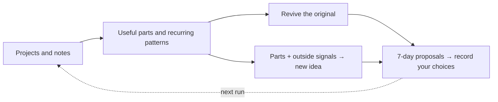

<p align="center">
  <picture>
    <source media="(prefers-color-scheme: dark)" srcset="assets/banner-poster-dark.svg">
    
  </picture>
</p>

# slop-compost

**English** | [한국어](README.ko.md)

[](LICENSE)
[](https://docs.claude.com/en/docs/claude-code)

**What can you do with the projects you never finished?**

Give this Claude Code plugin a folder, a GitHub URL, or a one-line idea you abandoned.

- Get reusable code, data, and ideas, plus patterns in where you stop—with file and line references.
- Explore two independent directions: revive the original or make something new from its parts. Each proposal comes with a 7-day experiment and concrete go/stop criteria.
- Reply with `A1 adopt, B1 reject`. Next time, it remembers your choices and asks, “Did you try it?”

## The 30-second version

**A shortened account of real runs, translated from Korean.** The author supplied four abandoned projects, then added one idea in a second run. Experiment targets and reported results are labeled separately below.

| What went in | What came back |
|---|---|
| “Couples’ budget app. Built the settlement logic, then quit.” | Keep the logic; try one landing page this week. After 100 visits: **10+ waitlist emails means success; fewer than 3 means stop.** |
| Code and notes from several projects | “Features come before anything an outsider can see.” Evidence: `idea-factory:IMPLEMENTATION-NOTES.md:5-16`, `couple-ledger:text:1` |
| Collection and deduplication code + a reporting idea | Send a manual report sample to **10 agencies. Success: 3+ replies and 1 paid pilot. Stop: 1 reply or fewer.** |
| A progress update on the next run | “Made a landing page: **40 visits, 2 signups.**” The next conversation starts from that history. |

The author rejected the budget-app proposal: “B2C doesn’t fit my intent.” That reason becomes useful context too. [Read the run logs](#run-log).

## Get started

Install inside Claude Code:

```text
/plugin marketplace add Leebonggu/slop-compost
/plugin install slop-compost@slop-compost-marketplace
```

Then hand it something unfinished. A GitHub URL or a quoted one-line idea works in place of a folder.

```text
/slop-compost:slop-compost ~/playground/my-project
```

You can also ask naturally: “What can I salvage from this abandoned project? ~/playground/my-project”

## How it works



- **Read and connect.** It looks for recurring behavior across projects, then asks you to confirm why you stopped in one batch.
- **Consider both directions independently.** Revival (Track A) and new ideas (Track B) do not see each other’s answers. Sometimes the revival answer is to let a project go and keep its parts.
- **Remember your choices.** Adopts, holds, rejections, and follow-up results stay in `~/.slop-compost` on your machine and inform later runs.

## Rules for useful output

| Output | Required |
|---|---|
| Lesson | An evidence location such as `file:line`, plus an observation that would prove it wrong |
| Every proposal | A first experiment that fits in 7 days, a numeric success criterion, and a stop criterion |
| New idea | Dated external evidence, a specific reason it could fail, and a similar failed attempt—or the actual queries that found none |

Its own slop becomes compost too. Output that fails a rule leaves the recommendations but stays in `compost.jsonl`. Repeated failures can prompt a proposed fix to the instructions; changes apply only after you approve them.

**It builds nothing.** It neither edits nor runs the projects it analyzes. It stops at proposals and records.

<details>
<summary>Why these choices?</summary>

The first answer can anchor the next one. Separate input bundles and two independent helper agents give revival and new ideas room to differ. If agents are unavailable, it saves and freezes A, then writes B from a separate input bundle.

Success stories leave out the attempts that failed, so new ideas need failure research too. A weekly experiment and a number make “validate the market” specific enough to act on. Lessons must also say what could prove them wrong.

Instruction changes are explicit. Five or more failures of the same rule across at least three runs trigger an improvement proposal. Approved changes live in local `overrides.md`, so plugin updates do not erase them. See the [design document](docs/DESIGN.md) (Korean) and [skill instructions](skills/slop-compost/SKILL.md).

</details>

## Sources

Nine default sources feed the new-idea direction. On the first run they are copied to `~/.slop-compost/sources.md`; your copy controls subsequent runs.

| Source ID | What it contributes |
|---|---|
| `hn-show` | Show HN launches and reactions |
| `github-trending` | Weekly trending open-source tools and reusable capabilities |
| `hf-papers` | New AI techniques; never treated as proof of demand |
| `trustmrr` | Startup examples with verified revenue |
| `failory` | Failed startups and founder interviews |
| `failure-search` | Shutdowns and post-mortems, searched in English and Korean |
| `geeknews` | GeekNews RSS and Korean developer news |
| `disquiet` | Korean makers’ products and build logs |
| `exploding-topics` | Topics gaining search interest |

The default list excludes Product Hunt, Reddit, and Indie Hackers because of automated-access restrictions. Paid or subscription-gated content is excluded too. See the [source access rules](skills/slop-compost/sources/defaults.md).

```text
/slop-compost:slop-compost sources list
/slop-compost:slop-compost sources add my-notes
# Answer the prompt: local, ~/my-notes, trend
/slop-compost:slop-compost sources disable trustmrr
/slop-compost:slop-compost sources remove disquiet
```

Add your own material as a `local` source: a folder or a git reference such as `~/my-scraper@data:items`. It reads existing refs without running `git fetch`. Scraper output in JSON needs `title`, `summary`, `source_url`, and `date`; Markdown works too. See [source management](skills/slop-compost/sources/README.md).

## Before you run it

- **Budget for a substantial run.** The author measured roughly **430k tokens across two runs**, about **8 minutes per run**. Your inputs will change that. Each project is capped at 50 core files.
- **Small additions get a lighter pass.** In an incremental run with just one new idea or draft, lightweight mode uses one external source per category (failure sources are always kept). Use `--full` to force a full re-analysis.
- **Run two has more to work with.** You get parts and patterns on the first run; remembering choices and checking what happened needs history.
- **Weak sources mean weak proposals.** Thin or stale results cannot establish demand. The AI can also misread a cited line, so check the references.
- **Search queries leave your machine.** Records are stored locally, but web queries use words drawn from your parts and lessons. Those project descriptions reach the search service.
- **This is v0.1.** The measurements above come from the author’s two runs, not a quality benchmark across a wide range of projects.

## FAQ

**Do I need code?** No. A draft or a sentence about something you abandoned is enough.

**Will it grade my code?** Code quality is not the point. It looks at how far you got, what stopped you, and what is reusable.

**What if I keep skipping the follow-ups?** After three skips, it stops asking about that candidate. Answering “not started” and skipping are recorded differently.

<details>
<summary>Shell or manual installation, and environment variables</summary>

Install the plugin from your shell:

```bash
claude plugin marketplace add Leebonggu/slop-compost
claude plugin install slop-compost@slop-compost-marketplace --scope user
```

Or install just the skill:

```bash
git clone https://github.com/Leebonggu/slop-compost.git
mkdir -p ~/.claude/skills
cp -R slop-compost/skills/slop-compost ~/.claude/skills/
```

For a manual install, invoke `/slop-compost ~/playground/my-project`. Source commands use the same shorter prefix: `/slop-compost sources list`.

| Variable | Default | Purpose |
|---|---|---|
| `SLOP_COMPOST_HOME` | `~/.slop-compost` | Record storage location |
| `SLOP_COMPOST_LANG` | Auto-detect | Force output language: `ko` or `en` |
| `SLOP_COMPOST_FULL_EVERY` | `10` | After this many new artifacts, re-read every recorded project and recompute patterns and lessons |

</details>

<a id="run-log"></a>
<details>
<summary>Real run logs — both runs</summary>

These are the existing README excerpts, translated from the original Korean run. Some candidates (A1, A3, B2) and the source list were omitted. The two rejected idea names are anonymized as “memo 1” and “memo 2”.

**Run 1 — first run, four artifacts**

```text
Mode: full (first run, no ledger - all 4 new)
Artifacts: idea-factory (read 18 of 122 source files), idea memos 1 and 2,
           couple-ledger ("Was building a shared budget app for couples. Built the
           settlement logic, quit without a landing page.")

## Patterns across artifacts
- Theme: porting a foreign MRR case into a Korean B2B tool - memo 1, memo 2
- Behavior: builds features before any outside touchpoint (landing, deploy, first customer)
  - idea-factory:IMPLEMENTATION-NOTES.md:5-16, couple-ledger:text:1
- Behavior: shelves or rejects ideas before running the validation written down for them - memo 1, memo 2

## Lessons
- L1 Projects that pile up features before anything an outsider can see (landing, deploy)
     stop right after the first output.
  - idea-factory:state.yaml:4-29, idea-factory:IMPLEMENTATION-NOTES.md:5-16, couple-ledger:text:1
- L2 Without my own context (profile) in the generator, output turns generic and I lose interest in a day.
  - idea-factory:agents/idea_generator.py:22-50, idea-factory:PLAN-phase3-7.md:27
- L3 Even candidates with a written validation plan get rejected on gut feeling before the test runs.
  - memo 1, memo 2

### If you revive the current idea (Track A)
#### A2 - Ship the couples' budget settlement as a single landing page first (unfinished: finish one thing)
- Parts: couple-ledger#p1 (settlement logic), couple-ledger#p2 (problem statement)
- Lessons -> changes: L1 -> freeze features; landing + waitlist first. No app code this week.
- First experiment (<= 7 days): landing with a settlement example + one-line promise,
  shared in 3 communities + 20 acquaintances. Cost: 0
- Success: >= 10 waitlist emails per 100 visits   |   Kill: < 3 after 100 visits
#### Release note
- idea-factory: no sign of motivation to continue -> let it go. Parts #p1-#p6
  (dedupe, LLM router, counter-argument schema, ...) stay in the parts list.

### If you go for a new idea (Track B)
#### B1 - Monthly rank + review report for local-marketing agencies (Naver Place)
- Who pays: small marketing agencies, ~30-50k KRW per client per month (assumption, to be tested)
- Parts: memo 1#p3 (report wedge), idea-factory#p2 (never-throw crawler contract), idea-factory#p1 (dedupe)
- External evidence: Naver started applying an AI review-reply tool to restaurants in beta,
  with other categories planned -> the reply feature gets absorbed by the platform, so go
  for reports - biz.sbs.co.kr - 2026-04-13
- Counter-evidence: rank data depends on unofficial collection and can break with one block;
  agencies often build reports themselves. Similar shutdowns: queries shown, none found
- First experiment (<= 7 days): check 3 competitors by hand -> one manual report for a real
  business -> send samples to 10 agencies
- Success: >= 3 replies AND 1 paid pilot   |   Kill: <= 1 reply

Composted 3 (02.generic-part: 1, 03.unfalsifiable: 1, 03.multi-claim: 1)

Judgments: A1 adopt, A2 reject "B2C doesn't fit my intent", A3 hold, B1 adopt "manual report is good", B2 reject
```

**Run 2 — same day, one more idea**

```text
> /slop-compost "A tool that auto-writes blog posts with AI and posts them to Naver. Quit over post quality."

Mode: incremental (1 new artifact; the 4 in the ledger are not re-analyzed)

## Recall
- Adopted 2, started 1 (2026-10-15:B1 in-progress "made a landing page: 40 visits, 2 signups")
- 2026-10-15:A1 not answered this time (skip 1/3)

## Patterns across artifacts
- Theme: stopped over LLM output quality - ai-naver-blog-writer:text:1, idea-factory:state.yaml:4-29

## Lessons
- L5 (new) When LLM output disappoints, I quit before revising the prompt or adding review.
  - ai-naver-blog-writer:text:1, idea-factory:state.yaml:4-29,
    idea-factory:agents/idea_generator.py:75 (PROMPT_VERSION still "v1.0")
  - Separate from L2 (cause: no context). L5 is about the reaction (quitting without iterating).

Composted 2 (03.unfalsifiable: 1, 05b.ev-no-source + ev-no-date + no-experiment + no-number: 1)
```

</details>

<p align="center">
  <picture>
    <source media="(prefers-color-scheme: dark)" srcset="assets/banner-dark.svg">
    
  </picture>
</p>

<p align="center"><b>Failure is the mother of success. Plant your slop.</b></p>

[MIT](LICENSE) © 2026 Leebonggu
